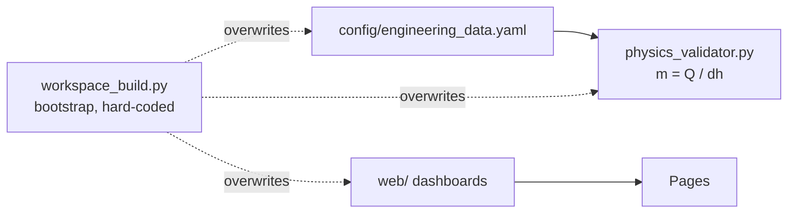

# cryogenic-accelerator-workspace — He-4 configuration, physics check and HMI demo workspace

<!-- markdownlint-disable MD001 MD013 MD022 MD029 MD031 MD032 MD033 MD040 MD060 -->

[](https://gbogeb.github.io/cryogenic-accelerator-workspace/)
[](#6-status-and-open-gates)
[](#6-status-and-open-gates)
[](#6-status-and-open-gates)

> **A small, self-regenerating workspace that links a YAML configuration of helium-4 heat loads to a mass-balance check and two browser dashboards — a demonstration and bridge worker, not a plant model of record.**

## At a glance

| | |
|---|---|
| **Domain** | Cryogenic accelerator infrastructure demo: He-4 near the lambda point (4.2–4.5 K), mass flow ṁ = Q_total / Δh from a polynomial NIST fit, an HMI workbench, plus the W111 QPS thermodynamic cross-check adapters |
| **EPICs carried here** | **W111** QPS thermo cross-check admission ([`triage/W111_QPS_THERMO_CROSSCHECK_ADMISSION.yaml`](triage/W111_QPS_THERMO_CROSSCHECK_ADMISSION.yaml)) · **Level-1 bridge worker** ([LEVEL1.md](LEVEL1.md)) · **May 2026 integration** ([report](integration_2026-05-22/INTEGRATION_REPORT.md)). No GitHub issues are open. |
| **Owner and decision authority** | Repository owner **GBOGEB**: admission to the default branch, releases and every external grant. No agent, bot or CI verdict holds this authority. |
| **Role in the federation** | A *bridge worker* (Level-1 role `BRIDGE_RTM_PHYSICS_WORKER`) between RTM-style configuration and physics checks. |
| **Owns** | `config/engineering_data.yaml` (demo configuration), `src/` physics and W111 adapters, `web/` dashboards, `workspace_build.py` |
| **Does not own** | QPS helium recovery analysis and validated parameters (cryoplant-project) · property libraries (CoolProp and similar) · federation governance (CODEX) |
| **Status snapshot** | `main@b001194`, read 15 November 2026 — 0 open issues, 0 open PRs. [Details ↓](#6-status-and-open-gates) |

**New here?** Read [§1](#1-why-cryogenic-accelerator-workspace-exists--bios), then the route that matches you:

| I want to… | Open this first |
|---|---|
| Open the dashboards | [Pages site](https://gbogeb.github.io/cryogenic-accelerator-workspace/) or [`web/index.html`](web/index.html) locally |
| Run the mass-balance check | [Run it locally](#7-run-it-locally) |
| See the staged CI suite | [`docs/ci-workflows/`](docs/ci-workflows/README.md) |
| Know what is not proven | [Status and open gates](#6-status-and-open-gates) |

## 1. Why cryogenic-accelerator-workspace exists — BIOS

**B — Baseline.** `config/engineering_data.yaml` declares version `2.4.1-build.108` (20 May 2026); its lineage `commit_sha` is a placeholder, not a Git SHA.

**I — Identity and integrity.** `workspace_build.py` is a **bootstrap generator**: it rewrites `config/engineering_data.yaml`, `config/knowledge_topology.json`, `src/physics_validator.py`, both dashboards and `README.md` from hard-coded text. It does not read your edits.

**O — Orchestration with ownership.** Configuration → `physics_validator.py` → HMI is the only flow (three-node topology in `config/knowledge_topology.json`).

**S — Safety and source-qualified status.** The helium properties are a polynomial fit, fine for a demo and not for design. There are no physics tests in `tests/` yet.

**Where authority lives:** [`config/engineering_data.yaml`](config/engineering_data.yaml) · [`config/knowledge_topology.json`](config/knowledge_topology.json) · [`LEVEL1.md`](LEVEL1.md).

## 2. From source to decision

1. Edit heat loads in `config/engineering_data.yaml`.
2. `physics_validator.py` computes mass flow and checks the balance against that file.
3. Dashboards are static files in `web/`; do **not** run `workspace_build.py` after editing, because it restores its defaults over your changes.
4. Pages publishes `web/`.
5. W111 guards run locally: a wrapper around the local helium engine and a dimensional audit of the YAML. No QPS reference data is compared yet; admission stays with cryoplant-project.

## 3. What is inside

| Block | Native source | Input → output | Boundary |
|---|---|---|---|
| Configuration | [`config/`](config/) | Heat loads, mass balances, topology | Demo values |
| Physics check | [`src/physics_validator.py`](src/physics_validator.py) | Configuration → ṁ, balance verdict | Polynomial He-4 fit |
| W111 adapters | [`qps_w111_property_adapter.py`](src/qps_w111_property_adapter.py), [`qps_w111_mass_balance_guard.py`](src/qps_w111_mass_balance_guard.py) | Local helium engine and YAML → admission and dimensional-defect guards | Quarantined, compatibility only; no QPS reference comparison yet |
| Dashboards | [`web/index.html`](web/index.html), [`web/app.html`](web/app.html) | Model → hub and Plotly HMI | A view |
| Bootstrap generator | [`workspace_build.py`](workspace_build.py) | Hard-coded text → config, validator, dashboards, README, bundle | **Destructive**: overwrites edits, including this README |
| Orchestration notes | Root `*_MCP_*.md`, [`CROSS_CHAT_ORCHESTRATION.md`](CROSS_CHAT_ORCHESTRATION.md) | Design notes for MCP bridges | Design, not running services |

## 4. Where cryogenic-accelerator-workspace sits in the federation

| Neighbour | Keeps | Interface with cryogenic-accelerator-workspace |
|---|---|---|
| [cryoplant-project](https://github.com/GBOGEB/cryoplant-project) (private) | QPS engineering SSOT and release identity | Validated QPS helium parameters and W111 admission; not yet compared here |
| [document-organization-system](https://github.com/GBOGEB/document-organization-system) | Material property dashboard | Integration plan in [`DOCUMENT_ORG_INTEGRATION_PLAN.md`](DOCUMENT_ORG_INTEGRATION_PLAN.md) |
| [pipeline-automation-hub](https://github.com/GBOGEB/pipeline-automation-hub) | Routing, JADE census, Mission Control | Routes Level-1 receipts |

## 5. Process diagrams

Declared architecture, not a run receipt.



## 6. Status and open gates

**Snapshot: `main@b001194`, read 15 November 2026.** Linked rows point at live owners; unlinked rows are as read on the snapshot date.

| Gate | Status | What would close it |
|---|---|---|
| CI workflows | The test/build/deploy suite the old README advertised is **staged as reference files** in [`docs/ci-workflows/`](docs/ci-workflows/README.md), **not installed**; installed workflows are branch hygiene, Level-1, triage and W111 | Owner installs the suite (`apply.sh`) or drops it |
| Pages | Branch-source build **succeeded** 25 Oct 2026 | — |
| Physics tests | **None** in `tests/` (only branch hygiene) | Mass-balance tests against reference values |
| Lineage | Configuration `commit_sha` is a placeholder | Bind to a real commit |
| Generator | `workspace_build.py` overwrites configuration and README with hard-coded text | Make it read the existing configuration, or retire it |
| Licence | **No `LICENSE` file**; the previous README called the code proprietary | Owner declares a licence |

## 7. Run it locally

```bash
pip install numpy pyyaml
python3 -c "import yaml,sys; sys.path.insert(0,'src'); from physics_validator import verify_mass_balance; print(verify_mass_balance(yaml.safe_load(open('config/engineering_data.yaml'))))"
# Do not run workspace_build.py on a working tree: it overwrites config, validator, dashboards and README.
```

Then open `web/index.html` (hub) or `web/app.html` (HMI workbench).

## 8. Evidence rules and non-compensation

- **Never run the bootstrap generator over edits**: it is destructive.
- **Demo, not design**: values and fits are illustrative.
- **Staged is not installed**: workflows in `docs/` do not run.
- **A PASS needs a test**: no balance verdict is claimed without one.

## 9. Repository map and next actions

| Folder | Open it for |
|---|---|
| [`config/`](config/) | Configuration and topology |
| [`src/`](src/) | Physics and W111 adapters |
| [`web/`](web/) | Dashboards and bundle |
| [`docs/ci-workflows/`](docs/ci-workflows/) | Staged CI suite |
| [`triage/`](triage/) | W111 admission and MIP notes |
| [`integration_2026-05-22/`](integration_2026-05-22/) | May 2026 integration report |
| [`level1/`](level1/), [`skill/`](skill/), [`MIP/`](MIP/) | Level-1 worker |

**Next actions** (match §6): make the generator non-destructive or retire it → decide on the staged CI suite → add physics tests → bind lineage to a real commit → declare a licence.

---

BIOS: Baseline · Identity · Orchestration · Safety. Admission authority: **GBOGEB**. Licence: not yet declared. Landing R2 on the [GEMINI skeleton](https://github.com/GBOGEB/GEMINI/blob/main/docs/landing/LANDING_SKELETON.md), snapshot `main@b001194`.
